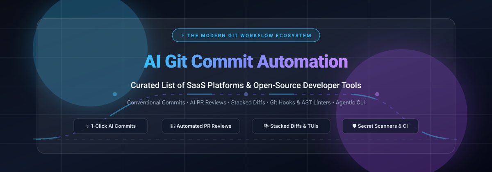

  

# 🚀 Awesome AI Git Commit Automation & Dev Tools Ecosystem 🤖

  
  
  
  
  
  

---

## 📖 Curated List of SaaS Products & Open-Source GitHub Projects

> **A comprehensive directory for AI Git Commit Generators, Conventional Commits CLI Tools, Automated PR Descriptions & Code Review Bots, Stacked Diffs, and Git Workflow Automation.**
>
> 📅 **Last updated: November 2026**

This curated knowledge base tracks high-impact **SaaS platforms** and **open-source developer tooling** for **AI Git Commit Automation & Modern Dev Workflows**. These tools analyze staged `git diff` changes to synthesize Conventional Commits messages, generate branch and pull-request descriptions, summarize complex multi-file diffs, run automated AI PR reviews, and streamline terminal Git workflows for developers, DevOps teams, and engineering organizations worldwide.

---

## 📑 Table of Contents
- [📊 Sector Overview & Market Dynamics](#-sector-overview--market-dynamics)
- [☁️ SaaS & Hosted Platforms](#️-saas--hosted-platforms)
- [🔓 Open-Source GitHub Projects](#-open-source-github-projects)
- [⭐ Star History](#-star-history)
- [💖 Support & Sponsorship](#-support--sponsorship)
- [🤝 How to Contribute](#-how-to-contribute)
- [📜 Disclaimer](#-disclaimer)

---

## 📊 Sector Overview & Market Dynamics

The global AI developer tools and code intelligence market is estimated at **$8 Billion to $10 Billion**, expanding rapidly at a **23%–27% CAGR** toward an anticipated $25+ Billion by the end of the decade. The AI code review and Git automation sector displays a **moderately fragmented "core vs. edge" dynamic**: while the edge is fiercely fragmented among specialized startups innovating on interactive diff UX, PR review agents, and local commit synthesizers, the platform layer demonstrates a powerful **winner-take-most** pull toward foundational ecosystem gatekeepers (such as Microsoft/GitHub, GitLab, and Atlassian) who bundle native AI assistants directly into code-hosting and IDE interfaces.

---

## ☁️ SaaS & Hosted Platforms

Below is the comparative breakdown of leading commercial SaaS platforms and hosted code intelligence suites, sorted by parent company scale (revenue/valuation descending):

| Product | Company Valuation / Revenue | Starting Price | Free Tier Limits | Key Highlights & Description |
| :--- | :--- | :--- | :--- | :--- |
| **[GitHub Copilot](https://github.com/features/copilot)** (PRs & CLI) | **~$3.8 Trillion** Market Cap *(Parent: Microsoft / MSFT)* | **$10.00 / user / mo** *(Copilot Pro, billed monthly)* | **Copilot Free**: Capped at **2,000 code completions/month** and baseline chat interactions for individual accounts; no credit card required. | Native GitHub suite providing 1-click commit message generation in VS Code/GitHub Desktop, PR diff summaries, automated code reviews, and terminal `gh` CLI recommendations. |
| **[Atlassian Bitbucket AI](https://bitbucket.org)** *(Rovo Dev)* | **~$38 Billion** Market Cap / **$6.57B** ARR *(NASDAQ: TEAM)* | **$3.65 / user / mo** *(Bitbucket Standard)*; Rovo Dev add-on starts at **$20.00 / dev / mo** | **Free forever plan**: Up to **5 users**, **1 GB** total workspace repository storage, and **50 CI/CD build minutes/month**; includes baseline **350 Rovo Dev credits/user/mo** on eligible Jira/Bitbucket plans. | Cloud Git hosting platform embedding Atlassian Intelligence / Rovo Dev to auto-generate commit messages, PR descriptions, and Jira-linked sprint and change summaries. |
| **[GitLab Duo](https://gitlab.com)** | **~$7.6 Billion** Market Cap *(NASDAQ: GTLB)* | **$29.00 / user / mo** *(GitLab Premium)*; includes bundled monthly GitLab Credits | **GitLab Free tier**: Up to **5 users** per top-level namespace, **5 GB** storage, and **400 compute minutes/mo**; AI platform allows test access via purchased credits (usage capped at $25,000/mo on demand). | Enterprise DevSecOps AI platform offering automated merge-request (MR) summaries, AI commit message generation, CI failure root-cause analysis, and code review suggestions. |
| **[CodeRabbit](https://coderabbit.ai)** | **$1.5 Billion** Valuation / **$100M+** ARR *(Series C)* | **$24.00 / developer / mo** *(Essentials, billed annually)* or **$30.00 / mo** *(month-to-month)* | **Free forever for Open Source (OSS)** on public repositories; for private repositories, includes **14-day free trial** with full review capabilities, reverting to **Free tier** with PR summaries only (capped hourly review allowances). | AI-first pull request review and summary platform delivering automatic PR walkthroughs, sequence diagrams, line-by-line bug detection, and 1-click commit fixes across GitHub and GitLab. |
| **[Graphite](https://graphite.dev)** *(Graphite Agent)* | **~$290 Million** Valuation *(Acquired by Cursor / Anysphere)* | **$20.00 / user / mo** *(Starter, billed annually)* or **$40.00 / user / mo** *(Team)* | **Hobby plan ($0 free forever)**: Unlimited personal repos with stacked diffs, CLI, and PR inbox, but **limited AI Reviews and chat queries**; 14-day full trial for teams. | Modern code review and stacked-PR platform featuring Graphite Agent AI reviews, automatic PR descriptions, and merge queue automation for fast-moving engineering teams. |
| **[Swimm](https://swimm.io)** | **~$100M – $250M** Valuation / **$33.3M** Funding | **$29.00 / user / mo** *(Pro plan)* | **Free forever plan**: Up to **5 users**, **1 private repository**, and unlimited public documentation; includes continuous doc-sync on merge, with conversational `/ask` restricted to paid plans. | AI-powered continuous documentation platform linking living architectural docs directly to Git commits and pull requests, auto-updating stale docs on merge. |
| **[GitKraken AI](https://gitkraken.com)** | **~$10M – $15M** ARR *(Resurgens Technology Partners)* | **$4.00 / user / mo** *(GitKraken Pro, billed annually at $48/yr)* | **Free forever plan**: Restricted to **public repositories and non-commercial/open-source use**; private repos and advanced AI merge conflict resolvers require a 7-day Pro trial or paid license. | Cross-platform Git GUI and CLI ecosystem featuring AI commit message generation, automated PR descriptions, merge conflict explanations, and multi-repo workspace insights. |
| **[Qodo Merge Cloud](https://qodo.ai)** *(formerly CodiumAI)* | **~$51M – $121M** Total Funding / **~$5M – $10M** ARR | **$30.00** starting credit pack *(2,500 pooled credits at $0.012/credit, ~$1.67/review)* | **14-day free trial**: Includes **100 AI reviews/day** with no credit card required; free permanent access available upon application for qualified open-source maintainers. | Managed AI pull-request assistant offering automated PR descriptions (`/describe`), diff walkthroughs, code suggestions (`/improve`), and test generation for GitHub, GitLab, and Bitbucket. |
| **[What The Diff](https://whatthediff.ai)** | Bootstrapped Indie SaaS | **$19.00 / month** *(Pro plan)* | **Free tier**: Capped at **25,000 tokens/month** (~10 pull requests/month) for PR diff explanations; full feature set tested with zero upfront cost. | AI-powered GitHub and GitLab app that translates complex pull request diffs into plain-English summaries, release notes, and changelogs for technical and non-technical stakeholders. |

---

## 🔓 Open-Source GitHub Projects

Explore the top open-source Git automation, AI commit generators, review bots, and Git CLI enhancements, ranked strictly by GitHub stars:

| Repository & Star Badge | Description & Workflow Focus |
| :--- | :--- |
| **[ollama/ollama](https://github.com/ollama/ollama)**  | 🦙 Get up and running with large language models locally. Serves as the premier local LLM engine behind tools like `opencommit`, `aicommits`, and `lumen` for completely private, zero-cost AI commits. |
| **[modelcontextprotocol/servers](https://github.com/modelcontextprotocol/servers)**  | 🔌 Official Model Context Protocol (MCP) servers, including the standard Git MCP server enabling AI coding agents to inspect `git status`, diffs, logs, and branch trees securely. |
| **[jesseduffield/lazygit](https://github.com/jesseduffield/lazygit)**  | 💻 Simple terminal UI for git commands that can be configured with custom keybindings to execute `opencommit` or local Ollama scripts for 1-key interactive AI commits. |
| **[Aider-AI/aider](https://github.com/Aider-AI/aider)**  | 🤖 AI pair programming in your terminal with automated git commits: automatically crafts structured, sensible Conventional Commit messages whenever file changes are applied. |
| **[typicode/husky](https://github.com/typicode/husky)**  | 🐶 Modern native Git hooks made easy. Pairs with AI commit tools and linters to trigger automated commit message authoring and validation before pushing. |
| **[gitleaks/gitleaks](https://github.com/gitleaks/gitleaks)**  | 🔒 Protect and safeguard code with pre-commit secret scanning, ensuring AI commit generators never accidentally commit credentials, API keys, or tokens. |
| **[charmbracelet/crush](https://github.com/charmbracelet/crush)**  | 🔨 Glamorous terminal CLI and developer experience toolkit by Charm for managing Git repos, interactive command palettes, and custom workflow scripts. |
| **[Wilfred/difftastic](https://github.com/Wilfred/difftastic)**  | 🔍 A structural, syntax-aware diff tool that understands AST semantics, producing significantly clearer diffs for both human engineers and LLM commit generators. |
| **[semantic-release/semantic-release](https://github.com/semantic-release/semantic-release)**  | 📦 Fully automated version management and package publishing. Parses AI-generated Conventional Commits (`feat`, `fix`, `chore`) to compute SemVer increments and changelogs. |
| **[gitbutlerapp/gitbutler](https://github.com/gitbutlerapp/gitbutler)**  | 🐙 Next-generation Git branch-management client in Rust and Svelte featuring virtual branches, drag-and-drop hunks, and integrated AI commit/branch authoring. |
| **[conventional-changelog/commitlint](https://github.com/conventional-changelog/commitlint)**  | 📏 Lint commit messages to ensure AI-generated commits strictly comply with Conventional Commits specifications and organizational formatting guidelines. |
| **[qodo-ai/pr-agent](https://github.com/qodo-ai/pr-agent)**  | ⚡ Open-source AI pull request bot supporting `/describe`, `/review`, `/improve`, `/changelog`, and `/ask` commands across GitHub, GitLab, and Bitbucket. |
| **[pre-commit/pre-commit](https://github.com/pre-commit/pre-commit)**  | 🪝 A multi-language framework for managing and maintaining pre-commit hooks, ideal for orchestrating local AI commit hooks and code sanity checks. |
| **[orhun/git-cliff](https://github.com/orhun/git-cliff)**  | 🧗 Highly customizable changelog generator written in Rust that parses Git history and AI-synthesized Conventional Commits using expressive Tera templates. |
| **[git-ecosystem/git-credential-manager](https://github.com/git-ecosystem/git-credential-manager)**  | 🔐 Secure, multi-platform Git credential storage for GitHub, Azure Repos, and GitLab to ensure smooth authenticated AI agent and CLI commits. |
| **[Nutlope/aicommits](https://github.com/Nutlope/aicommits)**  | ✨ Pioneering CLI utility that inspects staged `git diff` changes and generates Conventional Commits messages directly from your terminal or `prepare-commit-msg` hook. |
| **[idosal/git-mcp](https://github.com/idosal/git-mcp)**  | 🌐 Model Context Protocol (MCP) server for deep Git repository operations, allowing desktop LLMs and agents to run Git commits, logs, and branch diffs safely. |
| **[googleapis/release-please](https://github.com/googleapis/release-please)**  | 🤖 Google's automated release management bot that parses Conventional Commits history to autonomously maintain release PRs and `CHANGELOG.md` files. |
| **[di-sukharev/opencommit](https://github.com/di-sukharev/opencommit)**  | 🔥 Top AI Git commit CLI and GitHub Action that generates Conventional Commits with Gitmoji, Husky hooks, and local Ollama / OpenAI / Anthropic / Gemini support. |
| **[magit/magit](https://github.com/magit/magit)**  | 🧙 It's Magit! The legendary Git porcelain inside Emacs, easily extended with custom Elisp functions for automated LLM commit authoring and diff summarization. |
| **[NeogitOrg/neogit](https://github.com/NeogitOrg/neogit)**  | 🌲 Magit-inspired Git interface for Neovim, seamlessly paired with Lua AI plugins to summarize staged diffs and draft commit messages from the editor. |
| **[anc95/ChatGPT-CodeReview](https://github.com/anc95/ChatGPT-CodeReview)**  | 📝 Open-source GitHub Action and webhook bot that automatically reviews PR diffs and posts inline code feedback and commit recommendations on every push. |
| **[pwntester/octo.nvim](https://github.com/pwntester/octo.nvim)**  | 🐙 Edit and review GitHub issues, PRs, and comments within Neovim, enabling developers to review AI-generated pull request diffs without leaving the terminal. |
| **[jnsahaj/lumen](https://github.com/jnsahaj/lumen)**  | ⚡ Fast, modern Rust CLI for Git powered by AI that synthesizes commit messages, explains commits/diffs, summarizes branch changes, and drafts PR descriptions. |
| **[git-chglog/git-chglog](https://github.com/git-chglog/git-chglog)**  | 📜 Flexible CHANGELOG generator implemented in Go, driven by Git commit messages and fully customizable markdown templates. |
| **[afnanenayet/diffsitter](https://github.com/afnanenayet/diffsitter)**  | 🌳 A Tree-sitter based AST diffing tool that computes semantic syntactic changes, giving LLMs cleaner AST-level diff context for commit generation. |
| **[zurawiki/gptcommit](https://github.com/zurawiki/gptcommit)**  | 🦀 Fast Rust `prepare-commit-msg` Git hook that analyzes multi-file diffs to compose structured, coherent commit messages locally. |
| **[RomanHotsiy/commitgpt](https://github.com/RomanHotsiy/commitgpt)**  | 💬 Lightweight CLI that automatically drafts Git commit messages from staged diffs using OpenAI GPT models. |
| **[Zhengqbbb/cz-git](https://github.com/Zhengqbbb/cz-git)**  | 🎯 More engineered, lightweight Commitizen adapter and CLI with fuzzy search and integrated AI commit message generation. |
| **[insulineru/ai-commit](https://github.com/insulineru/ai-commit)**  | ⚙️ Minimalist Rust CLI utility that generates structured git commit messages via custom LLM prompts and diff staging. |

---

## 📈 Star History

---

## 💖 Support & Sponsorship

Thank you for exploring and bookmarking **Awesome-AI-Git-Commit-Automation-Dev-Tools**! 🎉

If you find this curated collection helpful for your daily developer workflow, please consider:
- ⭐ **Starring this repository** on GitHub to help other engineers discover it
- 🍴 **Forking it** to customize your personal or team developer toolkit
- 📢 **Sharing it** with your peers, developer communities, and on social networks

☕ **Support Ongoing Maintenance:**  
If you would like to buy me a coffee or sponsor this project, please visit the **[Sponsor Dashboard on GitHub Sponsors](https://github.com/sponsors/ishandutta2007)**. Every sponsorship helps keep this catalog up to date with the latest AI tooling!

---

## 🤝 How to Contribute

Contributions are welcome and highly encouraged! 

1. 🍴 Fork the repository.
2. 🌿 Create a feature branch (`git checkout -b add-my-tool`).
3. ✏️ Add your open-source tool or SaaS product in the appropriate section, following the existing table schema. Ensure links are direct, descriptions are objective, and pricing/limits are specific.
4. 💾 Commit your changes with a clear Conventional Commit message (`git commit -m 'feat: add my-tool to open-source table'`).
5. 🚀 Push to the branch (`git push origin add-my-tool`) and open a Pull Request.

---

## 📜 Disclaimer

*This repository is curated for informational and educational purposes. Product names, logos, and brands are property of their respective owners. Pricing tiers, token allocations, and feature sets are subject to change by vendor providers.*
